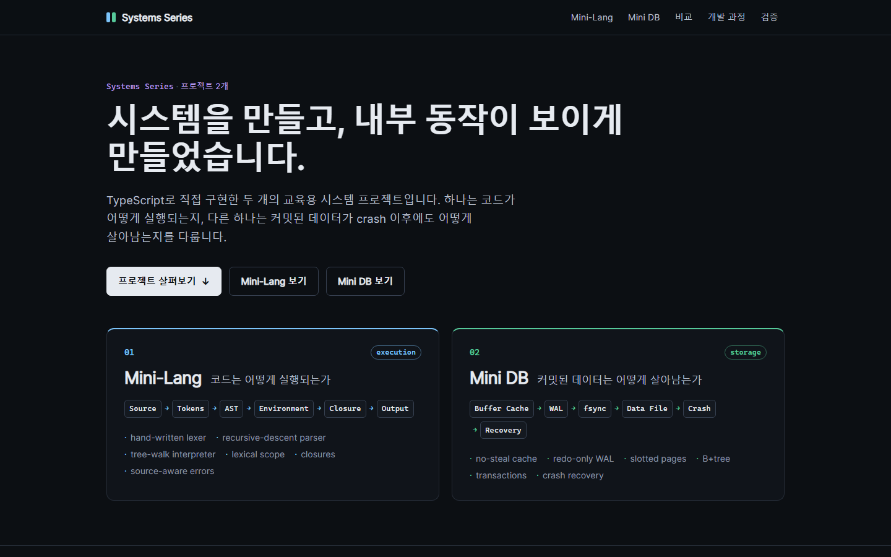
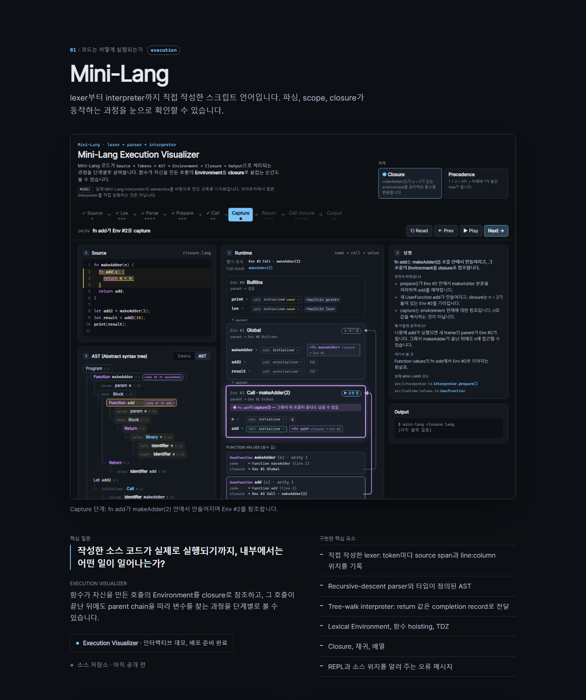
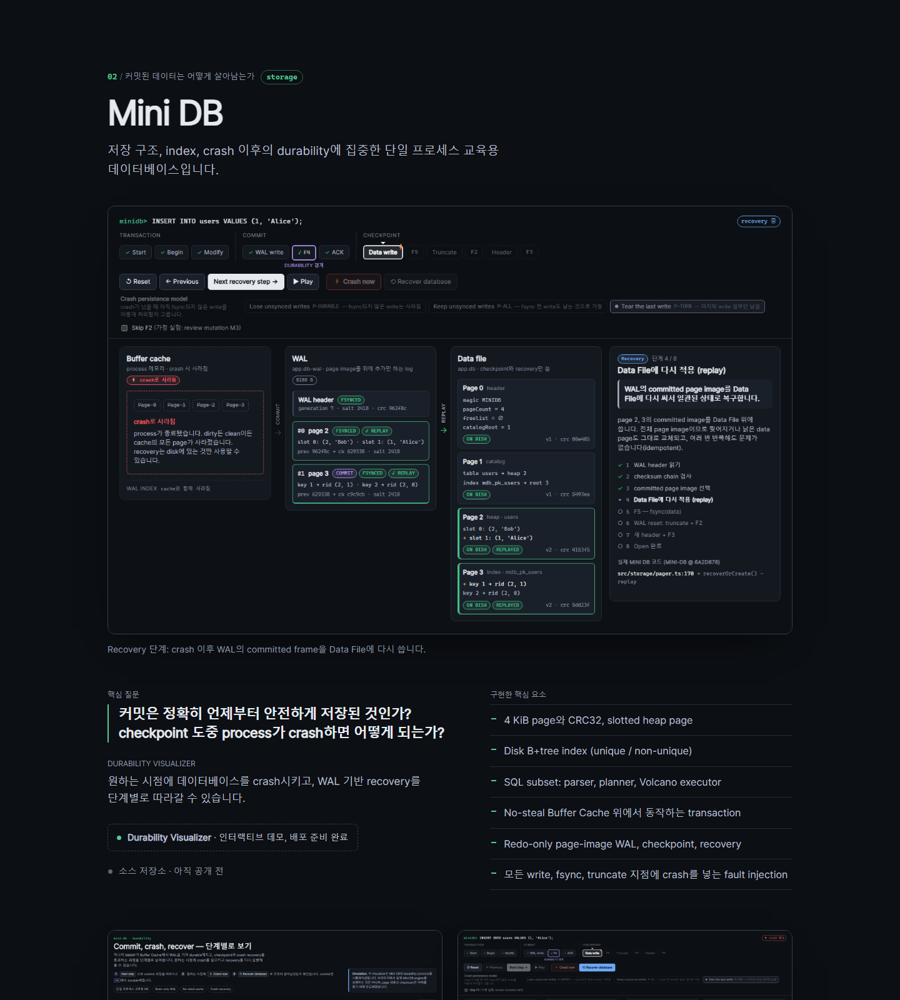

# Systems Series Showcase

**시스템을 만들고, 내부 동작이 보이게 만들었습니다.** 두 개의 교육용 시스템 프로젝트를 하나의 시리즈로 묶어 소개하고, 각 프로젝트의 인터랙티브 Visualizer로 이어 주는 정적 페이지입니다.

| | 프로젝트 | 질문 | Visualizer |
|---|---|---|---|
| 01 | **Mini-Lang**: 직접 작성한 스크립트 언어 (lexer, recursive-descent parser, tree-walk interpreter) | 문법이 어떻게 실행으로 바뀌는가? | Execution Visualizer: closure capture와 parent chain lookup |
| 02 | **Mini DB**: 단일 프로세스 교육용 데이터베이스 (slotted page, B+tree, redo-only WAL) | 커밋이 어떻게 durable해지는가? | Durability Visualizer: commit, crash, WAL recovery |



이 사이트는 두 프로젝트에 기능을 더하지 않습니다. 이미 만든 결과물을 처음 보는 사람이 빠르게 이해할 수 있도록 한곳에 모았습니다.

## 페이지 구성

1. **Hero**: 시리즈 이름, 핵심 문장, CTA, 두 프로젝트의 개요 카드(처리 흐름과 키워드)
2. **Mini-Lang**: 대표 screenshot, 핵심 질문, Visualizer 소개, 구현한 핵심 요소, 보조 screenshot 2장
3. **Mini DB**: 같은 구성
4. **두 시스템, 두 가지 질문**: execution semantics와 storage semantics를 항목별로 비교
5. **개발 과정**: Design → Implement → Test → Review → Visualize. 단계마다 각 저장소에 남은 기록을 함께 보여 주고, AI 사용 내역을 밝힙니다.
6. **검증 근거와 한계**: 프로젝트마다 검증 항목 4개와 각 주장의 검증 범위

| Mini-Lang 섹션 | Mini DB 섹션 |
|---|---|
|  |  |

추가 캡처: [비교 + 개발 과정](docs/images/04-compare-process.png), [검증 근거](docs/images/05-evidence.png), [모바일 375px](docs/images/06-mobile-375.png).

## 실행

Node.js 20 이상이 필요합니다.

```bash
npm install
npm run dev        # http://localhost:5173
```

```bash
npm run typecheck
npm test
npm run build      # typecheck 후 dist/에 정적 사이트 생성
npm run preview
```

## 구조

```text
src/
  data/projects.ts        페이지의 모든 문구: 프로젝트, 비교 항목, 개발 과정, AI 메모, URL 설정
  components/             Hero, ProjectSection, ProjectLinks, Screenshot, Comparison, Process, EvidenceSection, ...
  App.tsx, main.tsx
  useReveal.ts            섹션이 보일 때의 약한 전환 효과 (JS가 없거나 prefers-reduced-motion이면 꺼짐)
  styles.css              plain CSS, 어두운 테마, UI library 없음
  showcase.test.tsx       렌더링과 링크 테스트 (react-dom/server 사용, DOM library 없음)
public/images/            두 Visualizer 저장소에서 복사한 screenshot
docs/images/              이 Showcase의 캡처
```

컴포넌트는 `src/data/projects.ts`의 데이터만 렌더링합니다. 이 파일의 수치는 모두 각 프로젝트 저장소의 기록과 대조했고, 파일 상단에 출처 문서와 commit을 적어 두었습니다.

## 링크 설정 (URL config)

**GitHub 저장소와 데모 URL은 프로젝트를 공개하기 전까지 의도적으로 비워 둡니다.** `src/data/projects.ts`의 각 프로젝트에는 다음 값이 있습니다.

```ts
visualizerUrl: null,   // 예: 'https://<user>.github.io/mini-lang-execution-visualizer/'
repositoryUrl: null,   // 예: 'https://github.com/<user>/mini-lang'
```

- `null`이면 링크 대신 상태 문구("인터랙티브 데모, 배포 준비 완료" / "소스 저장소 · 아직 공개 전")를 보여 줍니다. 임시 링크는 만들지 않습니다.
- 절대 `http(s)` URL을 넣으면 CTA가 실제 링크(`Execution Visualizer 열기 ↗`, `소스 저장소 ↗`)로 바뀝니다.
- 그 밖의 값(`'#'`, `'TODO'`, `javascript:` 등)은 `publishedUrl()`이 무시하고 공개 전으로 처리합니다.

두 경우 모두 테스트로 확인합니다.

## Screenshot 출처

| `public/images/`의 파일 | 원본 |
|---|---|
| `minilang-closure-capture.png` (대표) | `mini-lang-execution-visualizer/docs/images/02-closure-capture.png` |
| `minilang-closure-call-lookup.png` | `.../03-closure-call-lookup.png` |
| `minilang-parse-ast.png` | `.../01-parse-ast.png` |
| `minidb-recovery-replay.png` (대표) | `mini-db-durability-visualizer/docs/images/03-recovery-replay.png` |
| `minidb-commit-f4.png` | `.../01-commit-f4.png` |
| `minidb-crash.png` | `.../02-crash.png` |

이미지는 이 저장소 안에 복사해 두었고, 외부 경로를 참조하지 않습니다. Visualizer 화면이 바뀌면 새 이미지를 다시 복사합니다.

## 배포

`npm run build`는 완전한 정적 사이트 `dist/`를 만듭니다. asset과 이미지 URL이 상대 경로(`base: './'`)라서 저장소 이름을 하드코딩하지 않았고, 도메인 루트나 하위 경로 어디에 올려도 동작합니다.

- **GitHub Pages**: `dist/`를 배포 (Pages workflow 또는 `gh-pages` branch)
- **Netlify / Vercel**: build command `npm run build`, output directory `dist`
- 그 밖의 정적 파일 서버나 object storage

라우팅, 서버 코드, 환경 설정은 없습니다. 페이지 안 이동은 `#section` anchor를 사용합니다.

## 접근성과 반응형

- `h1`은 하나이고, 섹션별 heading 구조, skip link, 눈에 보이는 focus outline을 갖췄습니다.
- 두 프로젝트는 색뿐 아니라 번호, 이름, 영역 태그(`execution` / `storage`)로도 구분됩니다.
- 모든 screenshot에 내용을 설명하는 alt text가 있고, 누르면 원본 크기 이미지가 열립니다. 휴대폰에서 자세히 볼 때 유용합니다.
- `prefers-reduced-motion`이면 부드러운 스크롤, 섹션 전환 효과, transition이 꺼집니다.
- 1440, 1024, 375px에서 가로 overflow가 없는지 확인했습니다. 좁은 화면에서는 비교 표가 라벨이 붙은 세로 목록으로 바뀝니다.

## 한계

- 이 페이지는 프로젝트를 소개할 뿐 실행하지는 않습니다. screenshot은 Visualizer의 정적 캡처입니다.
- 수치는 `src/data/projects.ts`에 적은 commit 시점의 저장소 기준이며, 자동으로 갱신되지 않습니다.
- Mini DB의 durability는 시뮬레이션한 파일 시스템 장애 모델과 단일 프로세스 범위에서, Windows에서만 검증했습니다. 실제 전원 차단(power loss)은 테스트하지 않았으며, 페이지에서도 검증 근거 옆에 이 내용을 밝힙니다.
- 검증 근거가 된 리뷰는 사람이 아니라 AI 에이전트가 수행했습니다. 페이지의 AI 사용 메모에도 적었습니다.
- 위 URL을 채우기 전까지는 데모와 저장소 링크가 없습니다.

## 기술 스택

React 19, TypeScript (strict), Vite, Vitest, plain CSS. Backend 없음.

## 라이선스

MIT. [LICENSE](LICENSE)를 참조합니다.
